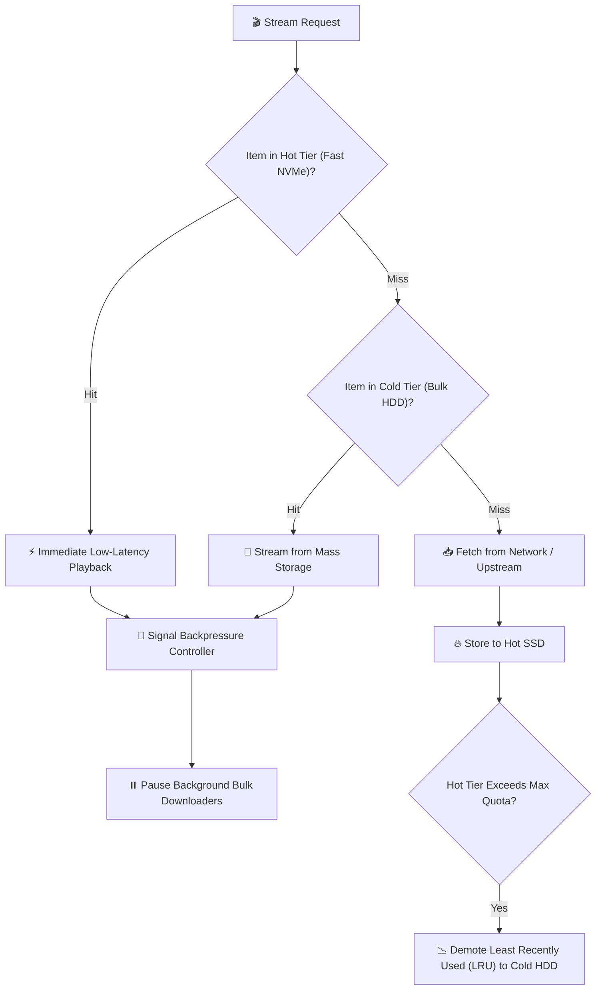

# 🗄️ Tiered Storage Cache (tieredcache)

### Multi-Tier (SSD + HDD) LRU Storage Cache with I/O Backpressure Prioritization

[](https://python.org)
[-blue.svg)](https://github.com/Kaio-Comk/Tiered-Storage-Cache)
[](https://opensource.org/licenses/MIT)

**Maximize storage efficiency on low-cost media servers.**  
*Combines blazing-fast NVMe/SSD hot caching with mass-capacity cold HDDs, automated LRU demotion, and live I/O backpressure throttling.*

---

## 🏗️ Architecture



---

## 📦 Installation

```bash
pip install git+https://github.com/Kaio-Comk/Tiered-Storage-Cache.git
```
